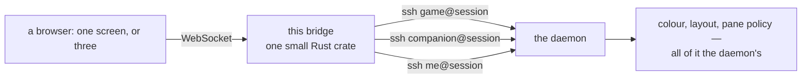

# INFOCompanion — web interface

The panes, in a browser, with nothing in between.



## Why Rust, and why the same crate

It speaks SSH with `russh` — the crate the daemon *serves* with, used here as a client. One SSH
implementation at both ends means there is no third-party client to disagree with our server,
and when the two do disagree there is one file to fix instead of two libraries to reconcile. It
is a second crate of the same project, built in the same image stage, and it adds nothing to the
runtime: the image is debian-slim, and all it gained was a static binary.

## The one rule

**This is a dumb mux.** It opens an SSH shell per pane and pipes bytes both ways. Every byte on
a screen was rendered by the daemon; nothing here knows what a turn is, what a game is, or what
any message means. The daemon's seat protocol — login name picks the view, `ClientMessage` in,
`CoreCommand` out — is the whole interface, and it was already there.

If this project ever needs to understand the protocol, it has stopped being this project. The
second rule follows from the first: the panes look right because the daemon says so, so the
palette here is a *theme* for the colour codes the daemon already emits (36 for a command, 1;37
for speech, 90 for a thought, 33 for a notice, 1;32 for a prompt, 1;35 for the player) — never a
second opinion about what a pane should show.

## Running it

In the image it is already running: the entry point starts it behind the daemon and prints the
address. Publishing the port is all that is needed.

```sh
INFOCOMPANION_WEB_PORT=8080        # published by docker-compose as ${INFOCOMPANION_WEB_PORT:-8080}
INFOCOMPANION_NO_WEBUI=true        # leave it off entirely
```

By hand, against a daemon listening on the host:

```sh
cd WebUI
INFOCOMPANION_DAEMON_HOST=127.0.0.1 \
INFOCOMPANION_PORT=2223 \
INFOCOMPANION_AUTH_PASSWORD=letsplay \
INFOCOMPANION_WEB_PORT=8080 \
INFOCOMPANION_WEB_ROOT="$PWD/public" \
cargo run --release
```

Needs a Rust toolchain to build and nothing at all to run.

## Configuration

| Variable | Default | What it is |
| --- | --- | --- |
| `INFOCOMPANION_WEB_BIND` | `0.0.0.0` | where to listen |
| `INFOCOMPANION_WEB_PORT` | `8080` | |
| `INFOCOMPANION_WEB_ROOT` | `./public` | the pages |
| `INFOCOMPANION_DAEMON_HOST` | `127.0.0.1` | where the daemon is |
| `INFOCOMPANION_PORT` | `2222` | its SSH port |
| `INFOCOMPANION_DAEMON_PORT` | — | overrides the port above, for pointing a pane at nothing |
| `INFOCOMPANION_AUTH_PASSWORD` | `letsplay` | the password it wants — held here, never in the browser |
| `INFOCOMPANION_PANE_SINGLE` | `player` | the login the one-screen page uses |
| `INFOCOMPANION_PANE_MULTI` | `game,companion,me` | the three, in order |
| `INFOCOMPANION_VOICE_URL` | *(nothing)* | where the companion's words are spoken, when a service speaks them: the base of an endpoint answering the OpenAI speech shape. Nothing means the browser's own voice reads the lines. The *name* is the personality file's `voice:` key, not a setting here |
| `INFOCOMPANION_VOICE_MODEL` / `_RATE` / `_SPEED` | `kokoro` / `24000` / `1.0` | what that endpoint calls its model, the rate it answers at, and how fast it says it — all passed through untouched, and `1.0` sends no speed field at all |
| `INFOCOMPANION_PANE_LABELS` | derived | what to call them, same order (see below) |
| `INFOCOMPANION_PLAYER_NAME` | `Peter` | the player, from the same setting the daemon uses |
| `INFOCOMPANION_GAMES_DIR` | `/games` | the library `/stats.json` counts (already set for the daemon; one environment serves both) |
| `INFOCOMPANION_STATE_DIR` | `/state` | where the `current-game` pointer is read, for the same route |

Seats are set in the configuration, not in the HTML, so `INFOCOMPANION_PANE_MULTI=game,me` is a
two-screen page without touching a file.

## The screens

Two of the three views, plus the fallback, are drawn on one of three chassis, and the config says
which (`shape`), so the browser never has to know that `me` means hands:

- **`monitor`** — a beige tube, the glass, the lamp in the corner, and the game on it. The bezel
  is deliberately thin: every millimetre of it is a line of the story nobody can read.
- **`panel`** — the same plastic with no artwork and no lamp, filling the pane. The companion's
  view is mostly words, and words do not need a bezel drawn round them.
- **`strip`** — three lines of phosphor in a piece of plastic on the desk. The pane you type
  into shows a prompt, what you are writing and the reply to it, and a full-size tube for that
  would be a wall wasted.

They sit as a pair of screens with the strip across the bottom, and the page fills the viewport
rather than sitting in a column, because a session is a screen and not a document.

A pane is measured, not guessed: the monitor is the largest exact 1000:880 box that fits
its cell, and the terminal is then fitted to that. Measurement needs a laid-out page, and a
document in a background tab is never laid out — `ResizeObserver` and animation frames do not
arrive while it is hidden — so the fits are run again whenever the page comes back into view or
focus. Open the panes in another tab and they are the right size when you get there.

Names come from configuration, never from the HTML: `game` is **THE GAME**, `companion`/`quill`
take the personality's name (`INFOCOMPANION_PERSONA`), `player` is **THE SESSION**, and the pane
you type into is named after the player (`INFOCOMPANION_PLAYER_NAME`, or **ME** if nobody has
said who that is).

### Controls

| Control | What it does |
| --- | --- |
| **full screen** (or `ctrl+shift+F`) | the whole page fills the display; the chord is captured before the terminal, or it would be typed into the game |
| **crt** | scanlines, a shadow mask, the bloom on the glass and a bar that rolls down the tube — on **every screen on the page**, which means the game and the single-screen view, and never the plain panel, where prose behind a shadow mask is not a favour |
| **− 13.5 +** | type size, **per pane** |

The monitor's control strip carries **three lamps** in the multiview, left to right: the screen
printing, the player typing, and the companion working. Two of them are lights for one pane's own
traffic — which is all a dumb mux can see, and it is enough: one lights when bytes arrive on the
game's pane, and one when a keystroke leaves the pane you type in (which may be in another cell on
the page). The third is the exception, and it is the reason the other two are still honest about what
they are: a light that only moved when bytes arrived said nothing during the seconds between the
daemon handing the model a turn and the first word coming back, which are exactly the seconds in
which a working companion and a hung terminal look the same. So it watches **the turn** instead. The
daemon writes an escape into the pane when the first model call of a turn leaves and another when the
reply has been delivered; the page watches those through the terminal's own escape handler, and the
lamp pulses slowly for as long as they last. Nothing is printed, nothing is scrolled, and the page
still reads no protocol — the daemon decided what a turn is, and this is the light that says it is
happening. Hovering names the pane each lamp belongs to. The single-screen page has one pane, so it
draws one lamp.

Both settings are kept in the browser, not in the page: a pane's type size is remembered against
its seat, and the size last chosen anywhere is the default for the panes you have not set — so
getting one screen right is enough, and a screen you have adjusted keeps its own answer. The CRT
switch is one setting for all of them, and it stays where you left it across a reload as well as
across the two pages. Full screen is the one thing that cannot be remembered: a browser only
gives it to a gesture.

Everything here is decoration over panes the daemon has already drawn.

## The instance's numbers

`GET /stats.json` reports what this instance *is*, from configuration and two folder listings —
no session, no login, no daemon, so it cannot go stale and cannot be wrong because a game is
mid-turn:

```json
{"game":"wishbringer","games":["advent","wishbringer"],"games_available":2,"persona":"james","player":"Peter","schema":1}
```

`player` and `persona` are the two variables in the table above; `game` is the `current-game`
pointer in the state directory; the library is the games directory counted by story extension —
`.md` sidecars, dotfiles and directories are not games. It is open like every other path here,
answers 200 whatever the folders happen to contain, and the whole of it — including what it must
never contain — is written down in the interface's own notes.

## The evening, read back

`GET /evening.txt` is the other side of the same idea: not what this instance *is*, but what the
last evening *did* — calls, spend and the spend per hour, cache share, latency percentiles, calls
by purpose with each one's share of the bill, and the findings the logs make measurable
(`act_missed` and what it cost, truncations, the allowance being hit, errands and missions, the
notebook's rewrites, the warns, the parser refusals). It reads the newest `agent-*.jsonl` and
`core-*.jsonl` in the state directory's `logs/`, parses them, and prints plain text; a missing
or half-written log is a smaller report, never an error. Nothing is cached and nothing is kept.

The game's own screen is not in those logs, and it is not served here either: every byte of it, in
the order it arrived, is in `state/playback/<game>.log`, written as the evening happens — including
the stretches the companion was not there for. That is a file, not a view, and whoever wants it
can read it.

## There is no authentication, on purpose

One server, one session, one person. There is no account, no cookie and no session state — the
page is open to anybody who can reach the port, and a proxy is the right place to ask for
something more. The daemon's password lives in this process's environment and is never sent to
the browser.

## Layout

```text
src/main.rs          HTTP, the routes, and what each response is
src/pane.rs          one browser socket → one SSH shell, bytes both ways
src/panes.rs         what a pane is: a seat, a name, a chassis, and who gets the cursor
src/assets.rs        the page whitelist (a shape, not a sanitiser)
src/stats.rs         the instance's numbers: config, the library, and the pointer
src/report.rs        the evening, read back out of the session's own logs
src/games.rs         the games with played data, and the write-up for coming back to one
public/index.html    what it is, and the three routes
public/term.html     one screen (the `player` view — everything, as it always was)
public/multiterm.html  two screens and the strip
public/app.js        one xterm per pane, the fit, the lamp, and the switches
public/app.css       the room, the plastic, the phosphor, and the crt
public/assets/       xterm.js (MIT, vendored), frame.svg (ours)
tests/smoke.sh       the pages, the guard, the instance's numbers, and a lone pane
```

`frame.svg` is drawn to a fixed geometry — the tube is x 46..954, y 46..792 of a 1000×880
viewBox, and the lamp sits at 930/832 — so `app.css` lays a terminal over it by percentage and
the two stay in step at any size. A pane's monitor is the largest exact 1000:880 box that fits
its cell, and that arithmetic is done in `app.js` (`fitMonitor`): every CSS arrangement of it
either overflows the cell or collapses to nothing, both of which have been seen here.

## The test

```sh
docker compose run --rm -T --entrypoint /bin/bash infocompanion /tests/webui.sh </dev/null
```

The `</dev/null` is not decoration: compose attaches the one-off container to this shell's
stdin, and when that never closes the run never returns — every check passes and then it sits
there looking hung. `-T` says the same thing on the tty side.

It starts the bridge on its own with no session behind it, then checks the pages, the config,
the path-traversal guard, the instance's numbers (against fixture folders), and — the
interesting one — that a pane which cannot reach the session *says so* instead of sitting
blank. An empty screen and a hung one look identical, and that is exactly the failure this
project keeps paying for.
